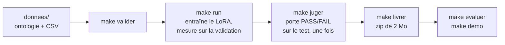

# git-assist-nlu

**Un petit modèle de langage fine-tuné pour comprendre des demandes git en français.**

Une demande devient une structure fermée (une intention et des slots), puis une
commande git :

```
phrase    : pousse la branche main sur origin
structure : git_push | remote=origin | branch=main
commande  : git push origin main
```

Le modèle est [Qwen3-0.6B](https://huggingface.co/Qwen/Qwen3-0.6B), spécialisé par un
adaptateur **LoRA de 2,3 Mo** entraîné sur un ordinateur portable, sans carte
graphique. Projet réalisé pour le cours de machine learning (EPITA, ING3), à la
suite du TP3 « porte de qualité sur une tâche NLU ».

## Résultat

Sur un test de 40 phrases jamais vues pendant l'entraînement, lu une seule fois :

| | LoRA (ce projet) | modèle de base | base + prompt système |
|---|---|---|---|
| intention juste | **92 %** (37/40) | 0 % | 0 % |
| slots (F1) | **90 %** | 12 % | 19 % |
| réponse entièrement juste | **88 %** (35/40) | 0 % | 0 % |

Porte de qualité : **PASS** (seuil : 70 % d'intentions justes, et au moins 30
points d'avance sur le modèle de base aidé d'un prompt).

> À lire avec ses [limites](#limites) : le prompt système n'a pas été réglé, et le
> test est petit.

## Essayer

```
uv sync
uv run python demo.py "crée une branche fix-timeout" "montre-moi les 6 derniers commits"
```

```
phrase    : crée une branche fix-timeout
structure : git_branch_create | branch=fix-timeout
commande  : git branch fix-timeout

phrase    : montre-moi les 6 derniers commits
structure : git_log | count=6
commande  : git log -n 6
```

Sans argument, `demo.py` passe en mode interactif. Le modèle est reconstruit à
partir du livrable (`livrables/`) : ni MLflow ni Docker ne sont nécessaires. Le
modèle de base (1,5 Go) est téléchargé au premier lancement. **Aucune commande
n'est exécutée**, elle est seulement affichée.

## Ce que l'assistant comprend

L'ontologie complète est dans [`donnees/ontologie.yaml`](donnees/ontologie.yaml).

| Intention | Exemple de demande | Commande obtenue |
|---|---|---|
| `git_commit` | enregistre avec le message ajout de la démo | `git commit -m 'ajout de la démo'` |
| `git_add` | ajoute main.py à l'index | `git add main.py` |
| `git_branch_create` | crée une branche feature-login | `git branch feature-login` |
| `git_branch_delete` | supprime la branche feature-login | `git branch -d feature-login` |
| `git_checkout` | bascule sur dev | `git switch dev` |
| `git_merge` | fusionne la branche dev | `git merge dev` |
| `git_push` | envoie la branche main sur origin | `git push origin main` |
| `git_pull` | récupère les changements de origin | `git pull origin` |
| `git_log` | affiche les 5 derniers commits | `git log -n 5` |
| `git_restore` | annule mes modifications sur main.py | `git restore main.py` |

Cinq types de slots : `message`, `file`, `branch`, `remote`, `count`.

## Comment ça marche



1. **Les données** ([`donnees/`](donnees/)) : 230 phrases rédigées pour le projet,
   réparties en trois fichiers sans phrase commune.

   | Fichier | Phrases | Rôle |
   |---|---|---|
   | `train.csv` | 150 | apprendre |
   | `validation.csv` | 40 | régler (nombre de pas) |
   | `test.csv` | 40 | juger, une seule fois |

2. **Régler sur la validation** : cinq entraînements, en ne faisant varier que le
   nombre de pas. Le test n'est pas ouvert à cette étape.

   | pas | époques | intentions justes | réponses exactes | perte de validation |
   |---|---|---|---|---|
   | 100 | 1,3 | 72 % | 62 % | 1.60 |
   | 200 | 2,7 | 90 % | 88 % | 1.01 |
   | **300** | **4** | **100 %** | **100 %** | **0.86** |
   | 400 | 5,3 | 95 % | 95 % | 0.83 |
   | 500 | 6,7 | 98 % | 98 % | 0.81 |

   À 100 pas, le modèle est sous-entraîné ; à partir de 300, les scores
   plafonnent (l'écart entre 300, 400 et 500 pas tient à une ou deux phrases).
   Run retenu : 300 pas.

3. **Juger sur le test** : le run retenu est comparé au modèle de base, seul puis
   aidé d'un prompt système. C'est le tableau du [résultat](#résultat).

4. **Livrer** : le modèle de base est public, on ne livre donc que ce qui a été
   appris. Le [livrable](livrables/) contient l'adaptateur, les données, le prompt,
   les notes et un rapport (version exacte du modèle de base, réglages, scores).
   `make evaluer` le rouvre et retrouve les scores déclarés à l'identique.

5. **Convertir en commande** ([`src/commande.py`](src/commande.py)) : la structure
   est traduite mécaniquement. Une intention hors ontologie ou un slot obligatoire
   manquant ne donne aucune commande.

## Limites

- **Le prompt système n'a pas été réglé.** La colonne « base + prompt » utilise le
  prompt généré depuis l'ontologie, sans exemples. L'avance de 92 points surestime
  donc l'avantage du fine-tuning face à un prompt soigné.
- **Le test est petit** : 40 phrases, une phrase vaut 2,5 points.
- **Train et test ont le même auteur**, leurs tournures se ressemblent sûrement.
  Un test écrit par quelqu'un d'autre donnerait probablement un score plus bas.
- **Une erreur peut être destructrice.** La structure est toujours bien formée,
  même quand l'intention est fausse. Sur le test :

  ```
  phrase    : je retourne sur la branche main
  structure : git_branch_delete | branch=main
  commande  : git branch -d main
  ```

  Avant d'exécuter quoi que ce soit, il faudrait une confirmation de
  l'utilisateur, au moins pour `git_branch_delete` et `git_restore`.
- **Une demande hors périmètre est rangée de force** dans une intention connue :

  ```
  phrase    : rebase ma branche sur main
  structure : git_pull | branch=main
  commande  : git pull origin main
  ```

- **Les commandes ne sont pas exécutées** : la mesure porte sur la structure, pas
  sur l'effet dans un dépôt.

Le détail des erreurs du test, des choix et de l'histoire des données est dans
[`donnees/NOTES.md`](donnees/NOTES.md).

## Refaire tout le cycle

Pré-requis : [uv](https://docs.astral.sh/uv/) et Docker.

```
cp .env.example .env
make setup      # MLflow (http://localhost:5000) et RustFS, dans Docker
uv sync
make test       # tests unitaires
make valider    # vérifier les données
make run        # entraîner + mesurer sur la validation (TRAIN_MAX_STEPS dans .env)
make juger      # porte de qualité sur le test
make livrer     # fabriquer livrables/livrable_<groupe>.zip
make evaluer    # réévaluer le livrable, sans MLflow ni Docker
make demo       # essayer des phrases
```

## Organisation du dépôt

```
donnees/               ontologie, train / validation / test, notes
src/
  data.py              lecture des données, format des réponses, score
  model.py, train.py   modèle de base, LoRA, entraînement
  evaluation.py        mesure sur un jeu, porte de qualité
  commande.py          structure -> commande git
  tracking.py          traçage MLflow, compteur de lectures du test
main.py                régler : entraîner et mesurer sur la validation
juger.py               juger : porte de qualité sur le test
livrer.py              fabriquer le livrable
evaluer_livrable.py    réévaluer un livrable
demo.py                phrase -> structure -> commande
valider_donnees.py     vérifier les données
prompt_lab.py          mesurer le modèle de base avec un prompt système
importer.py            importer un jeu de données existant (non utilisé ici)
livrables/             le livrable (zip de 2,1 Mo)
tests/                 tests unitaires
docs/                  énoncé de l'exercice
exemples/              exemple fourni avec l'énoncé (domotique)
```

Le squelette (cycle régler / juger / livrer, traçage MLflow) vient de l'énoncé du
cours : [`docs/EXERCICE_PROJET_NLU.md`](docs/EXERCICE_PROJET_NLU.md). Le sujet, les
données, la conversion en commande et la démo sont propres à ce projet.
